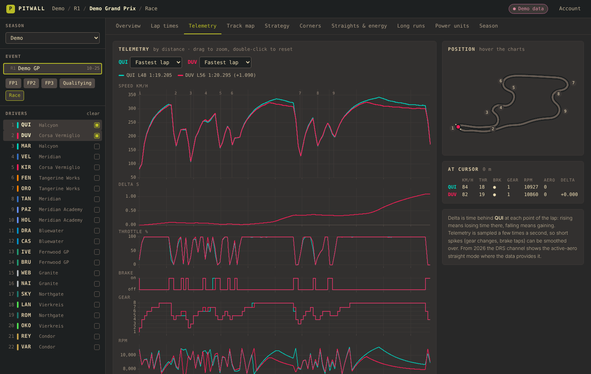
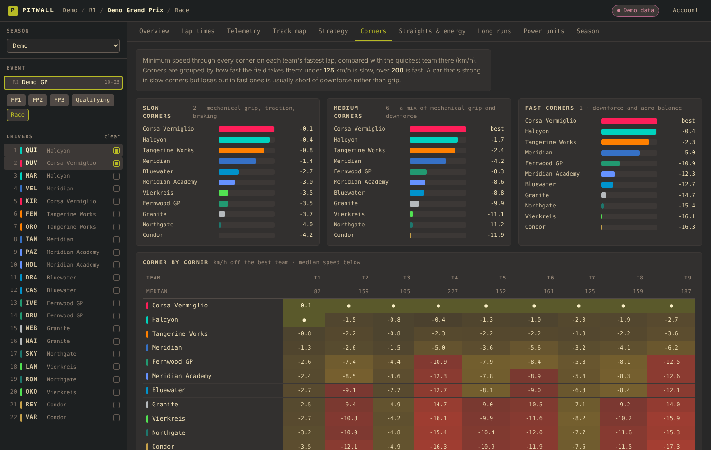

# Pitwall

A desktop app for digging into Formula 1 sessions: timing, tyre strategy and full car
telemetry, plus views that compare the cars themselves (corner speeds, straight-line
speed and energy clipping, long-run pace, power-unit families, form across a season).
The data comes from the official live-timing feed through [FastF1](https://github.com/theOehrly/Fast-F1).



## What's in it

| View | What it shows |
| --- | --- |
| Overview | Classification (race, qualifying or practice layout), weather, race control messages |
| Lap times | Every lap for the selected drivers with safety-car shading, bests table with sectors, ideal lap and speed traps, every-lap table |
| Telemetry | Up to four laps overlaid by distance: speed, time delta, throttle, brake, gear, RPM, DRS / active aero. Linked zoom, corner markers, a track map that follows the cursor |
| Track map | The lap drawn by speed, gear, throttle or braking, or mini-sectors coloured by the fastest driver |
| Strategy | Tyre stints for the whole field, positions and gap to the leader lap by lap |
| Corners | Minimum speed in every corner per team, grouped into slow, medium and fast corners |
| Straights & energy | Top speed, speed trap, traction out of slow corners, and how far each car runs flat out without gaining speed (energy clipping) |
| Long runs | Clean stints with fuel-corrected lap times and tyre degradation per lap |
| Power units | Teams grouped by engine maker, works team marked, so engine and chassis effects can be separated |
| Season | Each team's qualifying gap to the fastest team, round by round |



## Before you start: F1 TV

The live-timing service FastF1 reads now asks for an F1 TV subscription for every season.
Sign in from **Account** in the top right with your F1 TV email and password. The
password goes straight to F1's sign-in and is never saved; FastF1 keeps only the
resulting access token on your computer, and **Sign out** deletes it.

Without an account, **Demo** in the season list loads an invented race weekend so you
can try every view.

## Running it

You need Python 3.10 or newer and Rust (for building the window).

```
git clone <this repository>
cd Pitwall
python -m venv .venv
.venv\Scripts\pip install -r backend\requirements.txt      # Windows
# .venv/bin/pip install -r backend/requirements.txt        # macOS / Linux

cd src-tauri
cargo run --release
```

The app finds a `.venv` in the project folder by itself. To use another Python, set
`PITWALL_PYTHON` to its path. The built program is
`src-tauri/target/release/pitwall(.exe)` and can be started directly from there.

An installer can be made with the Tauri CLI (`cargo install tauri-cli`, then
`cargo tauri build`). The installed app still needs Python with the requirements
installed, found on `PATH` or through `PITWALL_PYTHON`.

### Where data is kept

Downloaded sessions are cached by FastF1 in your user cache folder (`pitwall`), so a
session loads quickly the second time. Telemetry is large, so the folder grows with every
session you open; it is safe to delete at any time.

## How it's put together

```
backend/pitwall_backend   Python: loads sessions with FastF1, runs the analysis, serves JSON
ui/                       The interface: plain HTML, CSS and JavaScript, charts by uPlot
src-tauri/                The desktop window; starts the backend and stops it on exit
```

The backend listens on `127.0.0.1` only, on a free port, and every request needs a
random token it prints at start-up, which the window passes to the page.

For working on the interface in a browser:

```
cd backend
python -m pitwall_backend --port 8765 --token devtoken
# in another terminal
cd ui
python -m http.server 8080
# open http://127.0.0.1:8080/?api=http://127.0.0.1:8765&token=devtoken
```

## Tests

From the `backend` folder, with the requirements installed:

```
python -m unittest discover -s tests -t .
```

This runs the unit tests (each calculation on small synthetic laps) and every
analysis on the demo weekend, in a few seconds, with no F1 data needed.

`tests/snapshots/real.json` holds summaries of what the analysis produced for
a set of real sessions (results, corner counts, rankings, race pace, clipping,
qualifying gaps, and how closely the telemetry's speed at the line matches the official
finish-line speed). To check that the analysis still produces them, using the
sessions already in your cache (nothing is downloaded, no sign-in needed):

```
PITWALL_REAL_TESTS=1 python -m unittest tests.test_real -v
```

On Windows PowerShell: `$env:PITWALL_REAL_TESTS=1; python -m unittest tests.test_real -v`.
Sessions not in the cache are skipped. To check only a few (the whole set takes about
ten minutes), name them: `PITWALL_REAL_SESSIONS=2026-16-Race,2026-13-Qualifying`. After a deliberate change to a
calculation, review what changed and store new summaries with
`python -m tests.snapshot --update`.

## Notes on the numbers

- Telemetry is sampled a few times a second and merged with position data, so short
  events (a brake tap, a gear change) can be smoothed over. Now and then a car's speed and
  position data drift apart; the lap then measures noticeably long or short, and the
  Telemetry view says so. The time delta and the mini-sectors are pinned to F1's official
  sector times, so they are exact at both sector lines and the finish line, and approximate
  within each sector.
- DRS shows as open or shut up to 2025. From 2026 the timing feed has no active-aero channel.
- Before the corner, straight and power-unit views use a lap, its telemetry is checked: it
  must join up (similar speed at its start and end), measure about the field's lap length,
  and be within 107% of the fastest lap. A failing lap is swapped for the driver's next
  quickest; a whole lap cut from the wrong point of the track is rotated to start at the line.
  The views list what was swapped. In Telemetry and mini-sectors, a lap whose telemetry is
  cut from a different point than the first lap's is turned to line up with it by track
  position, and the view says so.
- Corner, straight and power-unit views use each team's fastest lap, so they compare the
  cars best in qualifying; in races and practice they show a warning. In a race, top speed
  is each driver's typical figure over clean laps (one lap's peak swings with tows).
- A car's minimum speed in a corner moves about 2 km/h from one lap to the next, so corner
  verdicts need a 3 km/h gap and at least four corners of each kind. Clipping is ranked only
  where each driver's second-best lap puts the cars in roughly the same order.
- The fuel correction in Long runs starts from a full race's fuel (100 kg up to 2025, about
  70 kg from 2026) spread over the race's laps, at about 0.035 s per kg. It is an estimate;
  change it in the view. Race pace also reflects strategy: late stops for fresh tyres and
  laps spent in traffic are flagged.
- Engine makers per team are listed in `backend/pitwall_backend/teams.py` and need a
  line added when a new season changes them.

## License

Pitwall is free software: you can redistribute it and/or modify it under the terms of
the GNU Affero General Public License as published by the Free Software Foundation,
either version 3 of the License, or (at your option) any later version. See
[LICENSE](LICENSE).

Bundled: [uPlot](https://github.com/leeoniya/uPlot) (MIT, `ui/vendor/uPlot.LICENSE`).
Uses [FastF1](https://github.com/theOehrly/Fast-F1) (MIT).

Pitwall is unofficial and not associated with Formula 1 or its companies. F1, FORMULA 1
and related marks are trademarks of Formula One Licensing B.V.
